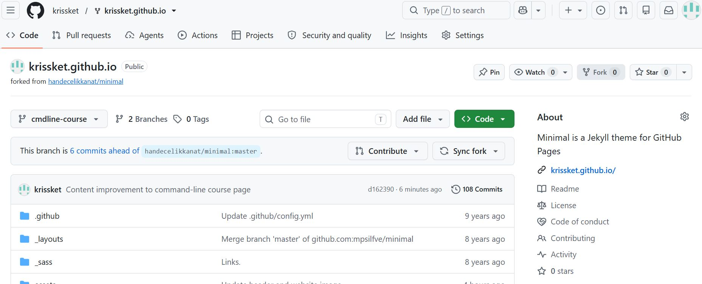

## Command Line Tools for Linguists INTRO

Course introduces command-line tools and Unix-like environments for text processing, corpus analysis, and basic scripting. It covers regular expressions, version control with Git, working on remote servers, installing software, and creating and hosting webpages with GitHub Pages.

## Module 1: Introduction to Command Line Environments

This module introduced the command line and basic commands for navigating directories and working with files. I learned how to navigate the file system using commands: check my current location, list files, and move between folders.

Example:

| Command | Purpose | Example |
|---|---|---|
| `ls` | lists all files in the current directory | `ls hello_world` |

## Module 2: Text Processing in UNIX

This module focused on using text processing tools in UNIX. I learned about character encoding and practised text processing tools. This was the most challenging part of the course because there was a lot of new commands to learn. For example, I learned how to sort contents of the file.

Some of the commands:

- `file` - identifies the type of a file
- `iconv` - converts text files from one character encoding to another
- `regex` - regular expression used to search for or match text patterns
- `egrep` - searches text for patterns using extended regular expressions
- `sed` - edits or transforms text using commands, ex. deletes lines

Example:

| Command | Purpose | Example |
|---|---|---|
| `sort` | sorts lines of text alphabetically or numerically | `sort languages_all.csv` |

## Module 3: Scripting, Configuration Files and Installing Programs

This module was dedicated to combining commands in scripts, configuring files and inastalling software. I learned that scripts can help with repetitive work, I tried using command-line parameters, conditional statements. I also learned more about managing environment variables, and installing software and Python packages.

Example:

| Command | Purpose | Example |
|---|---|---|
| `apt-get` | installs, updates, upgreads and removes software | `sudo apt-get install wget` |

## Module 4: Using ssh, scp and Version Control

This module focused on introduction of working with remote servers and  using Git to track changes in files and GitHub to store and share repositories. I practised creating branches, staging changes, committing them, and pushing commits to a remote repository.

Example:

| Command | Purpose | Example |
|---|---|---|
| `git push` | pushes changes to GitHub. (For ex. uploads a new  branch to GitHub) | `git push -u origin cmdline-course` |

## Final module: Building Webpages using GitHub Pages

Last module of a course offered a practival challenge. In the final part of the course I learned how to create and publish a personal website using GitHub Pages. I gained practical experience with  Markdown, Git branches, commits, and merging.

Illustration:

